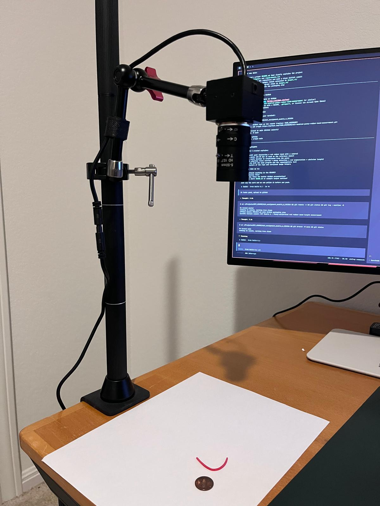

# MIT Assignment - Penny-Calibrated Rubber Band Length Measurement

Computer vision system to measure the length of a red rubber band using a USB camera, with a US penny as the calibration reference.

## Goal

Accurately measure the length of a physical red rubber band (or string) using only a camera.  
A standard US penny (diameter = **19.05 mm**) is used as a known reference object to establish the pixels-per-millimeter scale in every measurement.

This was developed as part of **MIT Module 6** (likely a measurement, metrology, or computer vision lab).

## Physical Setup

The USB camera is mounted in a fixed position above the work area, looking down at the penny and the red rubber band. This setup ensures consistent perspective and lighting for repeatable measurements.



The image above shows the physical arrangement used for all experiments.

## How It Works

### 1. Calibration (Penny as Reference)
- The system detects the penny using the **Hough Circle Transform**.
- Once the penny is found, its diameter in pixels is measured.
- Scale is calculated as:
  ```
  pixels_per_mm = detected_penny_diameter_px / 19.05
  ```

### 2. Rubber Band Detection
- The red rubber band is segmented using **HSV color thresholding** (red is detected in two hue ranges).
- Morphological operations clean up the mask.
- The largest connected red region is selected as the rubber band.

### 3. Length Measurement
- The segmented band is **skeletonized** (thinned to a 1-pixel wide line).
- Length is computed using the arc length of the skeleton contour.
- Final length in millimeters:
  ```
  length_mm = skeleton_length_px / pixels_per_mm
  ```

### 4. Live Visualization (Phase 1)
While setting up, the program shows a live camera feed with real-time overlays:
- Green circle + label around the penny
- Magenta outline + cyan bounding box around the red rubber band
- On-screen text showing:
  - Penny diameter (reference)
  - Calculated rubber band length
  - Current scale (px/mm)

## Project Structure

```
mit_assignment_module_6_101026/
├── module6_wire_length.py          # Main phased measurement program
├── coin_repeatability_test.py      # 2000 repeated measurements + CSV + histogram
├── docs/
│   └── images/
│       └── camera_setup.jpeg       # Physical camera mounting reference
├── images_v1/                      # Archived original captures (do not modify)
│   ├── captured_image.jpg
│   ├── live_annotated.jpg
│   └── binary_threshold_red_string.jpg
├── images_v2/                      # New data (repeatability test)
│   ├── coin_repeatability_data.csv
│   └── coin_diameter_repeatability_histogram.png
├── requirements.txt
├── .gitignore
└── README.md
```

## Running the Code

### 1. Setup

```bash
cd mit_assignment_module_6_101026
python -m venv .venv
source .venv/bin/activate
pip install -r requirements.txt
```

### 2. Main Measurement Program

```bash
python module6_wire_length.py
```

Controls during live preview:
- Press **`c`** or **Space** to capture
- Press **`q`** or **`Q`** to quit
- Press **ESC** to cancel

After capture you will see:
- Phase 2: Penny detection
- Phase 3: Red string segmentation (binary)
- Phase 4: Final annotated image with both penny and measured length

### 3. Repeatability Test

```bash
python coin_repeatability_test.py
```

This runs 2000 measurements of the penny, saves:
- `images_v2/coin_repeatability_data.csv`
- `images_v2/coin_diameter_repeatability_histogram.png`

## Results

- Typical detected penny diameter: ~128 pixels → ~6.72 px/mm
- The system can measure the red rubber band in real time with live visual feedback.
- A repeatability study (2000 samples) was performed on the penny to characterize measurement variation.

## Key Technical Details

- Language: Python + OpenCV
- Penny diameter used: **19.05 mm** (US one-cent coin)
- Coin detection: HoughCircles
- String segmentation: HSV color thresholding + morphology
- Length calculation: Morphological skeleton + contour arc length
- Live annotation: Overlays drawn directly on the camera feed

## Notes

- The external USB camera is used (`CAMERA_INDEX = 2`).
- All code follows a clean, phase-based structure as required by the assignment.
- Original captured images from development are preserved in `images_v1/`.

---

This project demonstrates practical computer vision techniques for metrology using a simple, low-cost reference object (a penny).
